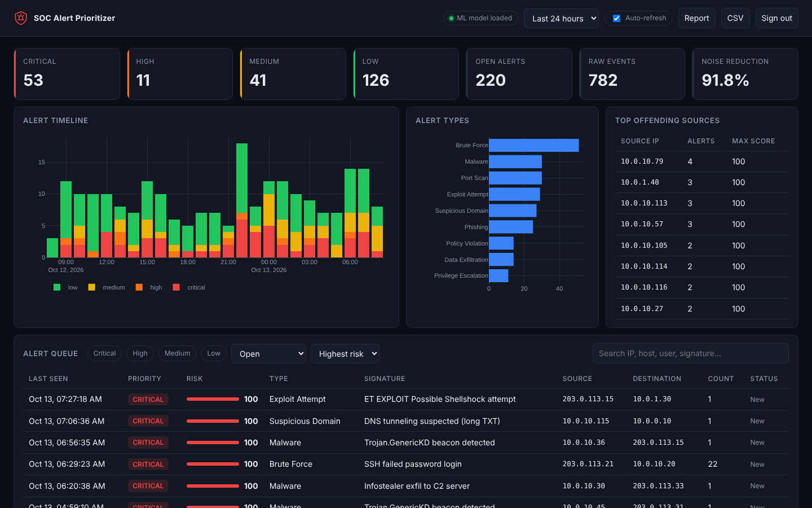
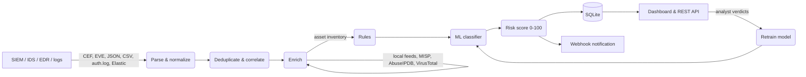

# SOC Alert Prioritizer


A triage engine for Security Operations Centers. It ingests alerts from SIEM,
IDS, EDR and log sources, enriches them with threat intelligence and asset
context, classifies them with rules and a machine-learning model, and ranks
everything on a single, explainable 0-100 risk score - so analysts start their
shift with the alerts that actually matter.



## Why

A mid-sized SOC sees thousands of alerts per day and most of them are noise:
scanners, adware, repeated failed logins, duplicate IDS hits. Vendor severity
alone is a poor guide - in the benchmark below it catches less than half of
the real incidents. This project combines the signals an experienced analyst
would check by hand (reputation of the indicators, how important the target
is, whether the activity repeats, what similar alerts turned out to be) and
does it automatically for every alert.

## Features

- **Collection & parsing** - CEF (ArcSight, Palo Alto, FortiGate, ...),
  Suricata EVE JSON, Linux `auth.log` (sshd), generic JSON/CSV with automatic
  field mapping (Elastic Common Schema, Splunk-style names), and a pull
  collector for Elasticsearch / OpenSearch. Format auto-detection.
- **Real-time mode** - `socprio watch` follows a log file (rotation-aware)
  and scores alerts in micro-batches; `POST /api/ingest` accepts events from
  a SIEM forwarder or SOAR webhook.
- **Deduplication & correlation** - repeats of the same activity within a
  configurable window are merged into one alert with an occurrence counter,
  which also turns single failed logins into brute-force detections.
- **Threat intelligence enrichment** - local blocklists (TXT/CSV, CIDR and
  parent-domain matching), MISP, AbuseIPDB and VirusTotal. Remote lookups are
  cached in SQLite, private addresses are never sent out, and a failing
  provider never blocks the pipeline.
- **Asset context** - YAML inventory with criticality 1-5 matched by CIDR or
  hostname pattern.
- **Rule engine** - declarative YAML rules (14 operators) that raise or lower
  scores, tag, re-classify or auto-close known noise such as the approved
  vulnerability scanner.
- **ML classification** - a Random Forest over numeric, categorical and
  TF-IDF signature features estimates the probability that an alert is a
  true positive. Analyst verdicts in the dashboard become training labels, so
  the model improves with use (`socprio train --from-db`).
- **Explainable risk scoring** - every alert carries a breakdown of how
  severity, asset, model, intel, volume and rules contributed to its score.
- **Analyst dashboard** - live queue with filters and search, priority
  timeline, top offending sources, alert detail with intel, related alerts,
  response playbook and a triage form. Works offline (no CDN needed).
- **Notifications** - Slack / Mattermost / Teams webhook when an alert first
  reaches (or escalates to) the configured priority.
- **Reports** - standalone HTML shift report with plotly charts and CSV export.
- **Research tooling** - synthetic labelled data generator, CIC-IDS2017/2018
  loader and a benchmark comparing rule-based and ML-based prioritization
  (precision, recall, F1, precision@k).
- **Secure by default** - log content is treated as hostile: validated,
  bounded and escaped everywhere it is rendered or exported. API key or
  signed-session authentication, CSRF and DNS-rebinding protection, strict
  CSP, signed model files and a hardened container. See
  [SECURITY.md](SECURITY.md).

## How it works



### Risk score

```
base   = weighted mean of  severity/10, (asset criticality-1)/4, P(true positive)
score  = base + (100 - base) x 0.7 x intel_factor      # intel only ever raises
       + volume bonus (up to +10 for repeated activity)
       + rule adjustments
```

| Score | Priority | Meaning |
|------:|----------|---------|
| 80-100 | Critical | Investigate now |
| 60-79  | High     | Investigate this shift |
| 40-59  | Medium   | Monitor / batch review |
| 0-39   | Low      | Informational, auto-closed when a rule says so |

Weights and thresholds live in [`config/settings.yaml`](config/settings.yaml).
When no model is trained yet the ML weight drops out and the others are
re-normalized, so the tool is useful from day one. Threat intel is applied as
an uplift rather than a weighted factor on purpose: feeds never cover
everything, so the absence of a match must not make an alert look safer.

More detail in [docs/architecture.md](docs/architecture.md).

## Quick start

```bash
git clone https://github.com/nlevenov/soc-alert-prioritizer.git
cd soc-alert-prioritizer
python -m venv .venv && source .venv/bin/activate
pip install -e ".[dev]"

socprio demo          # trains a model on synthetic history, ingests a day of
                      # alerts and serves the dashboard on http://127.0.0.1:8000
```

Or with Docker:

```bash
cp .env.example .env
# set SOCPRIO_API_KEY (and SOCPRIO_MODEL_KEY) - the container refuses to start without a key
docker compose up --build
```

Without an API key the server only listens on localhost. To expose it, set a
key, put a TLS reverse proxy in front and start it with
`socprio serve --host 0.0.0.0 --behind-proxy --public-url https://soc.example.internal`.

## Usage

```bash
# Score log files (format is auto-detected; --format to force it)
socprio ingest data/sample/firewall.cef data/sample/eve.json data/sample/auth.log

# Follow a live log
socprio watch /var/log/suricata/eve.json --format suricata --min-priority high

# Pull the last 4 hours from Elasticsearch
socprio elastic --since 4h --index "logs-*" --query 'event.kind:alert'

# Highest-risk open alerts in the terminal
socprio top -n 20

# Train the classifier: on labelled data, on CIC-IDS, or on analyst verdicts
socprio train --data data/sample/labelled_alerts.jsonl
socprio train --cicids Wednesday-workingHours.pcap_ISCX.csv
socprio train --from-db

# Benchmark rule-based vs ML-based prioritization
socprio generate -n 5000 --hours 96 -o var/bench.jsonl
socprio evaluate --data var/bench.jsonl

# Shift report
socprio report -o reports/shift.html --hours 12
socprio report -o reports/shift.csv
```

Sample output of `socprio ingest data/sample/auth.log`:

```
received 21 events -> 4 new alerts, 17 merged as repeats
priority: critical=2  high=0  medium=0  low=2

Time (UTC)           Alert type            Source IP        Score  Priority
---------------------------------------------------------------------------
2026-10-12 13:41:52  Brute Force           203.0.113.42       100  CRITICAL
2026-10-12 13:42:58  Account Compromise    203.0.113.42       100  CRITICAL
2026-10-12 13:50:02  Brute Force           10.0.10.35          28  LOW
2026-10-12 13:41:17  Authentication        10.0.10.21          21  LOW
skipped 1 records that were not alerts or could not be parsed
```

Eighteen failed SSH logins become one brute-force alert, and the successful
root login from the same blocklisted address that follows is re-classified as
an account compromise by rule `R006`.

## REST API

Interactive docs at `/docs` (OpenAPI). When `SOCPRIO_API_KEY` is set every
endpoint except `/health` requires it, either as an `X-API-Key` header
(scripts, SIEM forwarders) or through a browser session from `/login`.

| Method | Path | Purpose |
|--------|------|---------|
| `POST`  | `/api/ingest` | Ingest a batch: `{"format": "json\|suricata\|cef\|authlog", "events": [...]}` |
| `GET`   | `/api/alerts` | Query alerts (`priority`, `status`, `alert_type`, `q`, `hours`, `sort`, paging) |
| `GET`   | `/api/alerts/{id}` | Full alert with enrichment and score breakdown |
| `PATCH` | `/api/alerts/{id}` | Triage: `status`, `verdict`, `notes` |
| `GET`   | `/api/stats` | Counters, timeline and top sources for the dashboard |
| `GET`   | `/api/report.html`, `/api/report.csv` | Reports |
| `GET`   | `/api/model` | Model metadata and most important features |
| `POST`  | `/api/model/retrain` | Retrain from analyst verdicts |

```bash
curl -X POST localhost:8000/api/ingest -H "X-API-Key: $SOCPRIO_API_KEY" \
  -H "Content-Type: application/json" \
  -d '{"format": "json", "events": [{"timestamp": "2026-10-12T14:00:00Z",
       "signature": "Cobalt Strike beacon", "severity": 9,
       "src_ip": "10.0.10.25", "dst_ip": "203.0.113.10"}]}'
```

## Configuration

| File | Purpose |
|------|---------|
| [`config/settings.yaml`](config/settings.yaml) | Database, scoring weights, thresholds, intel providers, webhook, Elasticsearch. `${ENV_VAR:-default}` expansion keeps secrets out of the repo. |
| [`config/rules.yaml`](config/rules.yaml) | Triage rules. |
| [`config/assets.yaml`](config/assets.yaml) | Asset inventory and criticality. |
| [`feeds/`](feeds) | Local threat feeds (`.txt` / `.csv`). |

A rule looks like this:

```yaml
- id: R006
  name: Successful login from a blocklisted address
  conditions:
    - {field: alert_type, op: eq, value: Authentication}
    - {field: intel_score, op: gte, value: 50}
  score: 40
  set_type: Account Compromise
  tags: [escalate, possible-compromise]
```

## Evaluation

`socprio evaluate` trains on the oldest 70% of a labelled dataset and compares
four strategies on the newest 30%. An alert counts as *flagged* when it would
land in an analyst's queue (high or critical). Results on 5,000 synthetic
events (455 alerts after deduplication, 120 true positives):

| Strategy | Flagged | Precision | Recall | F1 | Precision@50 |
|----------|-------:|----------:|-------:|---:|-------------:|
| Vendor severity >= 7 | 99 | 0.475 | 0.392 | 0.429 | 0.54 |
| Rules + threat intel | 215 | 0.512 | 0.917 | 0.657 | 0.90 |
| ML only | 117 | 0.906 | 0.883 | 0.895 | 1.00 |
| **Hybrid (rules + intel + ML)** | 127 | 0.858 | **0.908** | 0.883 | 0.90 |

Observations:

- Vendor severity misses most incidents; the same signature fires for real
  attacks and for noise.
- Rules and intel alone find nearly everything but flag twice as many alerts
  as needed - recall without precision.
- The model brings precision. The hybrid score trades a little precision
  against ML-only for higher recall, while staying explainable and keeping
  working when there is no model or the model has not seen an attack type.

The synthetic data is generated from documented scenarios, so absolute numbers
are optimistic; use `--cicids` to repeat the experiment on CIC-IDS2017 /
CSE-CIC-IDS2018 flows, or `train --from-db` on your own verdicts.

## Project layout

```
src/socprio/
  ingest/       parsers (CEF, Suricata, auth.log, JSON/CSV), Elasticsearch, CIC-IDS loader
  enrich/       IOC extraction, threat intel providers + cache, asset inventory
  analysis/     rule engine, ML classifier, risk scoring
  api/          FastAPI app, dashboard templates and static assets
  pipeline.py   dedup -> enrich -> rules -> ML -> score -> store -> notify
  storage.py    SQLite persistence and statistics
  evaluation.py training helpers and strategy benchmark
  simulate.py   labelled synthetic alert generator
  cli.py        command line interface
  api/security.py  authentication, sessions, CSRF, security headers
config/         settings, rules, asset inventory
feeds/          local threat intelligence
data/sample/    example logs in every supported format
tests/          pytest suite
```

## Development

```bash
make dev      # editable install with test tools
make test     # pytest
make lint     # ruff
make security # bandit + pip-audit
```

## Roadmap

- Sigma rule import for the rule engine
- STIX/TAXII 2.1 feed provider
- Case grouping across related alerts (same host / user / campaign)
- Model drift monitoring and per-source calibration
- PostgreSQL backend for multi-analyst deployments

## License

MIT - see [LICENSE](LICENSE).
